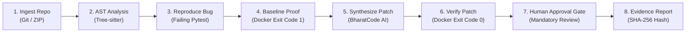
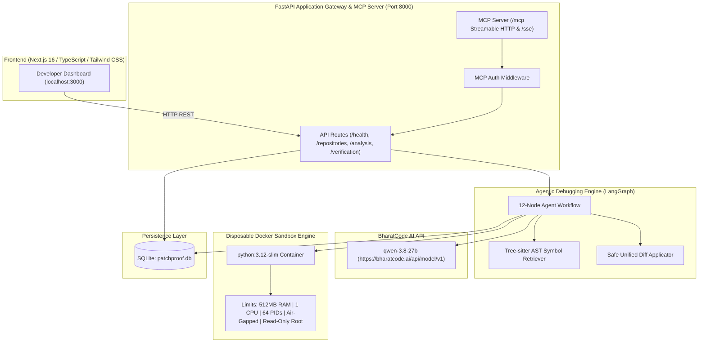
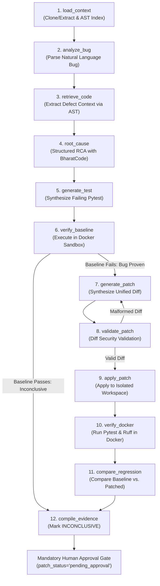

# PatchProof

> **"Don't trust generated code. Prove it works."**

PatchProof is an AI-powered automated bug reproduction, patch generation, and evidence verification platform built for the **BharatCode Build League 2026**.

---

## Problem Statement

Modern Large Language Models can generate plausible, syntactically clean code in seconds. However, **generated code cannot be trusted blindly**:
- **Silent Logic Regressions**: LLM-generated fixes frequently break unstated edge cases or introduce subtle business logic flaws that existing test suites were never written to detect.
- **Hallucinated Correctness**: AI models confidently assert that a bug is fixed without ever running the code.
- **Host Security Vulnerabilities**: Running AI-generated code or untrusted user repositories directly on host infrastructure risks remote code execution, secret exfiltration, and filesystem destruction.

---

## The PatchProof Solution

PatchProof replaces unverified trust with empirical proof through a closed-loop verification pipeline:
> **"A patch is never verified unless a reproducible failing test was run, proven to fail against the unpatched code, turned green by the patch, and validated against the entire regression suite in an isolated sandbox."**



---

## Key Features

- **AST-Based Repository Intelligence**: Indexes codebases, extracts functions/classes, and retrieves relevant snippets using non-executing Tree-sitter parsers. Untrusted code is never executed on the host.
- **12-Node LangGraph State Machine**: Orchestrates the multi-stage debugging lifecycle from initial bug report analysis through to cryptographic evidence generation.
- **Disposable Air-Gapped Docker Sandbox**: Executes test suites inside unprivileged (`1000:1000`), network-severed (`none`), read-only rootfs containers with dropped capabilities (`ALL`).
- **BharatCode AI Integration**: Uses the official BharatCode OpenAI-compatible API (`qwen-3.8-27b`) for root cause analysis and minimal unified diff synthesis.
- **Deterministic DEMO_MODE**: Enables zero-credit offline evaluations that deterministically synthesize bug scenarios while executing **real Docker containers** for baseline and patched verification.
- **Mandatory Human-in-the-Loop Sign-Off**: Prevents automated Git commits or pushes. All proposed patches require explicit developer approval (`pending_approval`).
- **Cryptographic Evidence Sealing**: Persists verification reports with deterministic SHA-256 integrity hashes for tamper detection.
- **Model Context Protocol (MCP) Server**: Exposes 9 tools over Streamable HTTP (`/mcp`), stdio, and legacy SSE (`/sse`) for external agent and IDE interoperability.

---

## System Architecture



### High-Level Architecture Overview

```text
┌────────────────────────────────────────────────────────────────────────┐
│                        PatchProof Architecture                         │
└────────────────────────────────────────────────────────────────────────┘

 [ Developer Dashboard ] (Next.js 16 App Router / TypeScript / Tailwind CSS)
             │
             │ HTTP / JSON API (NEXT_PUBLIC_API_BASE_URL)
             ▼
 [ FastAPI Gateway & MCP Server ] (Python 3.12 / Pydantic v2 / MCP 2.3)
      ├── /health & /api/v1/status
      ├── /api/v1/repositories (Git URL & ZIP metadata validation)
      ├── /api/v1/analysis (LangGraph 12-node agentic debugging workflow)
      ├── /api/v1/verification (Isolated Docker execution engine)
      ├── /mcp (Official Model Context Protocol Streamable HTTP transport)
      └── /sse (Legacy SSE transport for backward compatibility)
             │
      ┌──────┴───────────────────────────────────────────────────────┐
      ▼                                                              ▼
 [ BharatCode Model API ]                                   [ SQLite Persistence ]
  - Base URL: https://bharatcode.ai/api/model/v1              - Repositories Table
  - Model: qwen-3.8-27b                                       - Analysis Runs Table
  - Root Cause Analysis & Structured JSON                     - Workflow Events Table
  - Failing Pytest Generator                                  - Verification Runs Table
  - Minimal Unified Diff Synthesizer                          - Evidence Reports
      │
      ▼
 ┌───────────────────────────────────────────────────────────────────┐
 │ LangGraph Agent State Machine (12 Nodes)                          │
 │  load_context -> analyze_bug -> retrieve_code -> root_cause       │
 │  -> generate_test -> verify_baseline -> generate_patch            │
 │  -> validate_patch -> apply_patch -> verify_docker                │
 │  -> compare_regression -> compile_evidence                        │
 └───────────────────────────────────────────────────────────────────┘
      │
      ▼
 ┌───────────────────────────────────────────────────────────────────┐
 │ Disposable Docker Sandbox Engine                                  │
 │  ├── Base Image: python:3.12-slim (Fixed, Trusted)               │
 │  ├── Network: none (Air-gapped offline test execution)            │
 │  ├── User: 1000:1000 (Non-root unprivileged)                      │
 │  ├── Capabilities: cap_drop=["ALL"], no-new-privileges:true       │
 │  ├── Resources: 512MB RAM, 1.0 CPU, 64 PIDs, 30s timeout         │
 │  └── Filesystem: Read-only root + scoped tmpfs cache mounts       │
 └───────────────────────────────────────────────────────────────────┘
```

---

## LangGraph 12-Node Workflow



---

## Technology Stack

| Layer | Technologies |
|---|---|
| **Backend & API** | Python 3.12, FastAPI, Uvicorn, Pydantic v2, AnyIO |
| **Agent & Workflow** | LangGraph, LangChain Core |
| **Model Integration** | BharatCode OpenAI-compatible API (`https://bharatcode.ai/api/model/v1`, model `qwen-3.8-27b`), OpenAI Python SDK |
| **Code Intelligence** | Tree-sitter, tree-sitter-python (AST lexical & symbol queries) |
| **Docker Sandbox** | Docker SDK for Python, `python:3.12-slim` base image, cgroups limits |
| **MCP Integration** | Official MCP Python SDK (`mcp` 2.3), Streamable HTTP, stdio, SSE |
| **Persistence** | SQLite 3 (`sqlite:///./patchproof.db`), relational schema & audit logs |
| **Frontend UI** | Next.js 16 (App Router), React 19, TypeScript, Tailwind CSS, Lucide icons |
| **Testing & Security** | Pytest 9.2, Ruff 0.17, Bandit 1.9 (AST security analyzer) |

---

## Model Context Protocol (MCP) Server

PatchProof includes a production-quality MCP server built with the official Python MCP SDK (`mcp` 2.3). It exposes PatchProof's entire core capability set to external AI agents, Claude Desktop, Cursor, and IDEs without duplicating business logic.

### Supported Transports
- **Streamable HTTP (/mcp)**: Official modern Model Context Protocol Streamable HTTP transport with token authentication middleware.
- **Legacy SSE (/sse)**: Official SSE transport for backward-compatible SSE clients.
- **stdio**: Standard input/output transport for desktop integrations, Claude Desktop, Cursor, and agent sidecars.

### MCP Tool Catalog

| Tool Name | Parameters | Description | Security Constraints |
|---|---|---|---|
| `list_repositories` | `limit: int = 50` | Lists all registered repositories with status & language metadata | No secret or host path leakage |
| `search_code` | `repository_id: str, query: str, limit: int = 10` | Non-executing AST symbol and lexical search within repository | Read-only; bounded to repo root |
| `read_file` | `repository_id: str, relative_path: str, max_lines: int = 500` | Safely reads source files with line-count limits | Strict path traversal check; blocks `.env`, keys, `.git` |
| `analyze_bug` | `repository_id, bug_description, issue_url?, stack_trace?` | Initiates multi-step LangGraph debugging & verification loop | Ephemeral isolated workspaces; zero code execution on host |
| `get_analysis_status` | `analysis_id: str` | Retrieves real-time lifecycle status, verdict, and audit events | Read-only database query |
| `get_root_cause` | `analysis_id: str` | Retrieves structured root cause diagnosis and confidence score | Read-only database query |
| `get_proposed_patch` | `analysis_id: str` | Retrieves candidate unified diff patch | **Mandatory human approval notice; no auto-merge** |
| `run_verification` | `repository_id, command = 'pytest', run_ruff = True` | Runs tests & Ruff inside air-gapped Docker container | Strict allowlist: `pytest`, `ruff` only; non-root |
| `get_verification_report` | `run_id: str` | Retrieves evidence report, test metrics, and sanitized logs | Read-only database query |

### Running the MCP Server

#### Option 1: Stdio Transport (Claude Desktop / Cursor)
```bash
# From repository root:
backend\.venv\Scripts\python.exe backend/mcp_server.py --transport stdio
```

To configure in **Claude Desktop** (`claude_desktop_config.json`):
```json
{
  "mcpServers": {
    "patchproof": {
      "command": "C:\\Users\\<USER>\\...\\PatchProof\\backend\\.venv\\Scripts\\python.exe",
      "args": [
        "C:\\Users\\<USER>\\...\\PatchProof\\backend\\mcp_server.py",
        "--transport",
        "stdio"
      ]
    }
  }
}
```

#### Option 2: Standalone Streamable HTTP Transport
`ash
# From repository root:
backend\.venv\Scripts\python.exe backend/mcp_server.py --transport streamable-http --host 127.0.0.1 --port 8001
`

#### Option 3: Standalone SSE Transport (Legacy)
`ash
# From repository root:
backend\.venv\Scripts\python.exe backend/mcp_server.py --transport sse --host 127.0.0.1 --port 8001
`

#### Option 4: Unified FastAPI Endpoints
When the FastAPI backend is running, the MCP endpoints are automatically accessible at:
- **Streamable HTTP**: http://127.0.0.1:8000/mcp
- **Legacy SSE**: http://127.0.0.1:8000/sse

#### MCP Network Authentication
When `MCP_API_KEY` is configured in `backend/.env`, incoming HTTP/SSE requests must provide the key via:
- `Authorization: Bearer <MCP_API_KEY>`
- or `X-API-Key: <MCP_API_KEY>`

Requests missing or presenting invalid keys receive `HTTP 401 Unauthorized`. Leaving `MCP_API_KEY` blank enables open local development mode.

---

## Directory Structure

```text
PatchProof/
├── backend/
│   ├── app/
│   │   ├── api/
│   │   │   └── routes/
│   │   │       ├── analysis.py            # LangGraph workflow, model status, approval
│   │   │       ├── health.py              # Health (/health) and Status (/api/v1/status)
│   │   │       ├── repositories.py        # Safe Git URL & ZIP validation
│   │   │       └── verification.py        # Isolated Docker execution & reports
│   │   ├── core/
│   │   │   ├── config.py                  # BharatCode settings, CORS, sandbox & MCP limits
│   │   │   ├── execution_policy.py        # Command allowlist & security profiles
│   │   │   └── logging.py                 # Structured logging
│   │   ├── database/
│   │   │   └── database.py                # SQLite schema & workflow events
│   │   ├── mcp_server/
│   │   │   ├── __init__.py                # MCP package init
│   │   │   ├── auth.py                    # Token authentication middleware
│   │   │   ├── server.py                  # MCPServer initialization & CLI runner
│   │   │   └── tools.py                   # 9 MCP tools wrapping service layer
│   │   ├── models/
│   │   │   └── schemas.py                 # Pydantic request & response models
│   │   ├── services/
│   │   │   ├── bharatcode_service.py      # BharatCode OpenAI-compatible API client
│   │   │   ├── code_search_service.py     # Tree-sitter AST parser
│   │   │   ├── docker_sandbox.py          # Disposable Docker container runner
│   │   │   ├── patch_service.py           # Unified diff parser & safe applicator
│   │   │   ├── repository_service.py      # Non-execution repository management
│   │   │   ├── repository_understanding.py# File tree indexing & line-numbered snippets
│   │   │   ├── test_runner.py             # Pytest & Ruff test orchestrator
│   │   │   ├── verification_service.py    # Verification lifecycle & evidence compiler
│   │   │   └── workflow_engine.py         # 12-node LangGraph agent state graph
│   │   └── main.py                        # FastAPI entry point, lifespan & MCP mount
│   ├── tests/
│   │   ├── test_bharatcode_service.py     # Model client & error handling tests
│   │   ├── test_config.py                 # Settings & AST parser tests
│   │   ├── test_health.py                 # Health & status endpoint tests
│   │   ├── test_mcp_server.py             # 9 MCP tools, auth, schemas & path safety tests
│   │   ├── test_phase3_ai_workflow.py     # LangGraph workflow & patch proof tests
│   │   ├── test_repositories.py           # Safe repository validation tests
│   │   ├── test_sandbox.py                # Command allowlist & Docker sandbox tests
│   │   └── test_verification.py           # Verification endpoints & report lifecycle
│   ├── .env.example
│   ├── requirements.txt
│   ├── mcp_server.py                      # Standalone MCP CLI runner
│   ├── pytest.ini
│   └── ruff.toml
├── frontend/
│   ├── src/
│   │   ├── app/
│   │   │   ├── globals.css                # Dark developer theme styling
│   │   │   ├── layout.tsx                 # Root layout
│   │   │   └── page.tsx                   # Main dashboard
│   │   ├── components/
│   │   │   ├── BugAnalysisPanel.tsx       # Full agentic debugging UI & human approval
│   │   │   ├── Header.tsx                 # Branding & live status badges
│   │   │   ├── RecentAnalysisList.tsx     # Historical analysis runs & verdicts
│   │   │   ├── RepositoriesList.tsx       # Registered repositories table
│   │   │   ├── RepositoryConnect.tsx      # Git URL input & ZIP dropzone
│   │   │   ├── Sidebar.tsx                # Dark developer sidebar navigation
│   │   │   ├── VerificationCards.tsx      # Operational telemetry cards
│   │   │   └── VerificationPanel.tsx      # Docker execution & evidence inspector
│   │   ├── lib/
│   │   │   └── api.ts                     # Typed API client
│   │   └── types/
│   │       └── api.ts                     # TypeScript API schemas
│   ├── package.json
│   ├── tsconfig.json
│   └── .env.example
├── examples/
│   └── demo_discount_repo/                # Deterministic demonstration repository
│       ├── calculator/
│       │   ├── __init__.py
│       │   └── discount.py                # Reproducible percentage discount defect
│       ├── tests/
│       │   ├── __init__.py
│       │   └── test_discount.py           # Baseline decimal test suite
│       └── README.md
├── docs/
│   ├── ARCHITECTURE.md                    # System architecture & LangGraph specification
│   ├── DEVELOPMENT.md                     # Local setup & testing instructions
│   └── SECURITY.md                        # Container isolation & execution guardrails
├── .gitignore
├── pytest.ini
└── README.md
```

---

## Quickstart Guide

### 1. Environment Setup

#### Backend Configuration
```bash
cd backend
cp .env.example .env
```

Configure `backend/.env`:
```ini
# BharatCode API Configuration (Judges: Configure your API key here)
BHARATCODE_BASE_URL=https://bharatcode.ai/api/model/v1
BHARATCODE_MODEL=qwen-3.8-27b
BHARATCODE_API_KEY=your_key_here

# Offline Demo Mode (Set to true to run deterministic workflow without API credits)
DEMO_MODE=false

# MCP Server Security
MCP_API_KEY=
MCP_HOST=127.0.0.1
MCP_PORT=8001
MCP_TRANSPORT=sse

# Persistence & Server Binding
DATABASE_URL=sqlite:///./patchproof.db
HOST=127.0.0.1
PORT=8000
ENVIRONMENT=development
LOG_LEVEL=INFO
CORS_ORIGINS=["http://localhost:3000","http://127.0.0.1:3000"]

# Docker Sandbox Limits
DOCKER_PYTHON_IMAGE=python:3.12-slim
DOCKER_MEMORY_LIMIT=512m
DOCKER_TIMEOUT_SECONDS=30
WORKSPACE_BASE_DIR=./workspaces
```

#### Frontend Configuration
```bash
cd frontend
cp .env.example .env.local
```

Configure `frontend/.env.local`:
```ini
NEXT_PUBLIC_API_BASE_URL=http://localhost:8000
```

---

### 2. Running the Application

#### Start Backend (FastAPI + MCP SSE)
```bash
# Windows
backend\.venv\Scripts\python.exe -m uvicorn app.main:app --host 127.0.0.1 --port 8000 --reload --app-dir backend

# Linux / macOS
uvicorn app.main:app --host 127.0.0.1 --port 8000 --reload --app-dir backend
```
- Interactive Swagger UI: [http://localhost:8000/docs](http://localhost:8000/docs)
- Health Check: [http://localhost:8000/health](http://localhost:8000/health)
- Model Status: [http://localhost:8000/api/v1/analysis/model/status](http://localhost:8000/api/v1/analysis/model/status)
- Official Streamable HTTP MCP Endpoint: [http://localhost:8000/mcp](http://localhost:8000/mcp)
- Legacy MCP SSE Endpoint: [http://localhost:8000/sse](http://localhost:8000/sse)

#### Start Frontend (Next.js Dashboard)
```bash
npm --prefix frontend run dev
```
- Dark Developer Dashboard: [http://localhost:3000](http://localhost:3000)

#### Start Standalone MCP Server (Stdio)
```bash
backend\.venv\Scripts\python.exe backend/mcp_server.py --transport stdio
```

---

### 3. Offline / Demo Mode (Evaluating without Paid API Credits)

If you do not have an active BharatCode API subscription or wish to evaluate PatchProof deterministically offline:
1. In `backend/.env`, set:
   ```ini
   DEMO_MODE=true
   ```
2. Run the bug analysis against `examples/demo_discount_repo` with bug description:
   `The calculate_discount function returns an incorrect result when whole percentage 20 is passed.`
3. **What happens**:
   - Model analysis and synthesis are deterministically generated and clearly flagged as `[DEMO MODE]`.
   - **Real test execution is NOT bypassed**: The reproduction test is written to disk, executed inside the Docker sandbox against the unpatched code, and proven to fail.
   - The security-validated unified diff is applied to an isolated workspace.
   - The patched test suite and Ruff static checks are executed for real inside the Docker sandbox, turning green.
   - A complete evidence report is generated and stored in SQLite.

---

### 4. Running Verification & Tests

#### Full Backend Automated Test Suite (65 Tests)
```bash
# Run all 65 tests from repository root (100% passing)
backend\.venv\Scripts\python.exe -m pytest -q
```

#### Code Quality & Security Audits
```bash
# Run Ruff linter (0 errors, clean)
backend\.venv\Scripts\ruff.exe check backend

# Run Bandit AST security scan (0 vulnerabilities across 4,633 LOC)
backend\.venv\Scripts\python.exe -m bandit -r backend/app
```

#### Frontend Typechecking & Linter
```bash
# TypeScript strict type check (0 errors)
npm --prefix frontend run typecheck

# ESLint audit (0 errors, 0 warnings)
npm --prefix frontend run lint

# Next.js Turbopack production build (exit code 0)
npm --prefix frontend run build
```

---

## Judge Evaluation Guide (BharatCode Build League)

PatchProof is designed for immediate evaluation by hackathon judges. You can evaluate the platform in either **Live API Mode** (using your own BharatCode API credentials) or **Deterministic Demo Mode** (zero API credits required).

### Option A: Evaluation with Live BharatCode API Key
If you have an active BharatCode API subscription:
1. In `backend/.env`, set:
   ```ini
   BHARATCODE_BASE_URL=https://bharatcode.ai/api/model/v1
   BHARATCODE_MODEL=qwen-3.8-27b
   BHARATCODE_API_KEY=your_actual_bharatcode_api_key_here
   DEMO_MODE=false
   ```
2. Start the backend (`uvicorn app.main:app ...`) and frontend (`npm run dev`).
3. Open `http://localhost:3000` to register repositories, trigger real-time bug analyses via BharatCode `qwen-3.8-27b`, inspect generated patches, approve patches via human review, and verify them in Docker.

### Option B: Evaluation via Deterministic DEMO_MODE (Recommended without API credits)
If you do not have BharatCode API credits:
1. In `backend/.env`, set:
   ```ini
   DEMO_MODE=true
   ```
2. In this mode:
   - The LLM synthesis steps (root cause analysis, reproduction test synthesis, and patch proposal) are deterministically generated and clearly labeled `[DEMO MODE]`.
   - **Real test execution is NOT mocked**: Disposable Docker containers are genuinely spawned, network is air-gapped, tests run against the code, baseline failures are proven, patches are applied to isolated workspaces, and patched test suites turn green.

### Reproducible End-to-End Walkthrough (`examples/demo_discount_repo`)
1. **Register Repository**:
   - Via Dashboard: Upload `examples/demo_discount_repo` or register `patchproof-org/demo-discount-repo`.
   - Via MCP: Call tool `list_repositories`.
2. **Trigger Bug Analysis**:
   - Bug Description: `The calculate_discount function returns an incorrect result when whole percentage 20 is passed.`
3. **Inspect 12-Node Workflow Execution**:
   - `load_context` -> `analyze_bug` -> `retrieve_code` -> `root_cause` -> `generate_test` -> `verify_baseline` (fails in Docker with `assert -19000.0 == 800.0`) -> `generate_patch` -> `validate_patch` -> `apply_patch` -> `verify_docker` (passes in Docker with `2 passed`) -> `compare_regression` -> `compile_evidence`.
4. **Inspect Evidence & Mandatory Human Approval Gate**:
   - The patch is marked `pending_approval`. No patch can be exported or committed without developer sign-off.
   - The evidence report includes execution logs, test metrics, and a cryptographic SHA-256 integrity hash.

---

## Standalone Verification Scripts

We provide three standalone verification scripts in the `scripts/` directory for fast, automated judge audits:

### 1. Real Docker End-to-End Verification
```bash
backend\.venv\Scripts\python.exe scripts/verify_docker_e2e.py
```
- Spawns live Docker containers (`python:3.12-slim`).
- Proves baseline regression test genuinely fails with `-19000.0 != 800.0` (Exit code `1`).
- Applies unified diff patch to isolated workspace (zero mutation to original source repo).
- Proves patched test suite genuinely passes (`2 passed`, Exit code `0`).
- Runs full 12-node LangGraph workflow in real Docker sandbox and verifies database evidence integrity.

### 2. Live Container Security & Isolation Audit
```bash
backend\.venv\Scripts\python.exe scripts/verify_isolation.py
```
- Inspects running container parameters directly through Docker daemon API.
- Confirms: `network_mode="none"`, `user="1000:1000"`, `cap_drop=["ALL"]`, `security_opt=["no-new-privileges:true"]`, `read_only=True`, 512MB RAM, 1.0 CPU, 64 PIDs, and scoped tmpfs cache mounts.
- Confirms zero dangling containers after disposal.

### 3. MCP Streamable HTTP 9-Tool Happy Path
```bash
backend\.venv\Scripts\python.exe scripts/verify_mcp_happypath.py
```
- Starts a background Uvicorn server on port 8997.
- Connects using the official MCP Python SDK `streamable_http_client`.
- Executes all 9 MCP tools sequentially against real endpoints and disposable Docker containers.
- Validates tool responses, error guards, diff outputs, and SHA-256 verification hashes.

---

## Transparent Disclosures & Limitations

1. **BharatCode API Credits**:
   - During local development, live inference against the BharatCode API could not be tested because our account lacked API credits (HTTP 402 Payment Required).
   - The integration code uses the official BharatCode OpenAI-compatible API (`https://bharatcode.ai/api/model/v1`) with model `qwen-3.8-27b`.
   - The model status endpoint (`/api/v1/analysis/model/status`) accurately reports configuration and reachability.
   - When judges supply a funded `BHARATCODE_API_KEY` in `backend/.env`, live model inference is used automatically.
2. **Supported Languages**:
   - Phase 2 through Phase 7 support Python repositories (`python:3.12-slim`). Expanding to TypeScript/JavaScript, Go, and Rust is architected into the modular sandbox design for future versions.
3. **Execution Guardrails**:
   - Only allowlisted commands (`pytest`, `ruff`) can be executed in Docker containers. Arbitrary shell execution and unauthorized flags (`--override-ini`, dangerous arguments) are strictly rejected before container launch.

---

## Phase Status Summary

| Phase | Description | Status |
|---|---|---|
| **Phase 1** | Production-Quality Foundation and Application Scaffold | **COMPLETED & VERIFIED** |
| **Phase 2** | Secure Docker Sandbox & Test Execution Engine | **COMPLETED & VERIFIED** |
| **Phase 3** | BharatCode Model API Integration & LangGraph Agentic Debugging Engine | **COMPLETED & VERIFIED** |
| **Phase 4** | Production Model Context Protocol (MCP) Server & Hackathon Submission Readiness | **COMPLETED & VERIFIED** |
| **Phase 5** | Final QA, Security Audit, MCP Streamable HTTP & Hackathon Submission Readiness | **COMPLETED & VERIFIED** |
| **Phase 6** | Real Docker End-to-End Verification (Live Containers, 0 Mocks) | **COMPLETED & VERIFIED** |
| **Phase 7** | Final Hackathon Submission Audit, Repository Hygiene & Verification Report | **COMPLETED & VERIFIED** |

---

## License

This project is licensed under the Apache License 2.0. See the [LICENSE](LICENSE) file for complete details.

---

## Submission Repository

- **Public Repository**: [https://github.com/NitinDhiman-007/PatchProof](https://github.com/NitinDhiman-007/PatchProof)
- **Hackathon Track**: BharatCode Build League 2026
- **Submission Information File**: [BharatCode.txt](BharatCode.txt)
